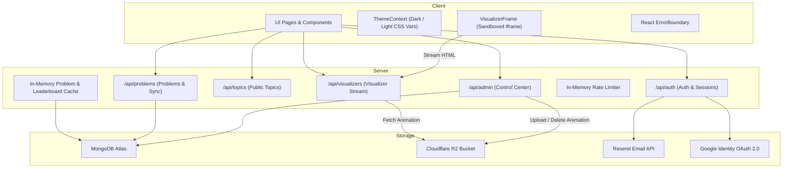

# DSA Sheet — Agent Instructions & Knowledge Base

Welcome to the **DSA Sheet** workspace. This repository is a production-ready, full-stack Data Structures and Algorithms (DSA) learning and practice platform.

This document serves as the top-level operating guide for AI agents and human developers. Follow these conventions and instructions strictly when working in this codebase.

---

## 1. Project Overview

**DSA Sheet** combines a curated 500+ problem catalog across 20 curriculum pillars with interactive HTML5 algorithm visualizers, daily challenges (Problem of the Day), a gamified progression leaderboard, and an administrative control center.

Key capabilities include:
- **Curriculum & Practice Tracks**: 20 DSA categories (Arrays, Trees, Dynamic Programming, Graphs, etc.) with solved progress, revision queues, and personal notes.
- **3-Pillar Interactive Visualizers**: Standalone interactive HTML animations categorized by Algorithm, Data Structure, or Problem, hosted in Cloudflare R2 or served via local fallbacks.
- **Daily Challenge (POTD)**: Automatic or manual daily problem assignment with consecutive streak tracking.
- **Gamified Leaderboard**: Live ranking powered by solve counts, streaks, and progressive level calculation ($\text{Level} = \lfloor\sqrt{\text{totalSolved} \times 0.45}\rfloor + 1$).
- **Platform Control Center**: Comprehensive admin interface (`/admin`) for managing topics, problems, visualizers, user roles, leaderboard settings, and security audit logs.

---

## 2. Architecture Overview

The repository is structured as a decoupled client-server architecture:

---

## 3. Technology Stack

### Client
- **Runtime & Bundler**: Vite `5.4.x` + TypeScript `5.5.x`
- **Framework**: React `18.3.x` with React Router DOM `6.22.x`
- **Styling**: Tailwind CSS `3.4.x` with CSS custom properties (design tokens)
- **Icons**: Lucide React (`lucide-react`)
- **Authentication Client**: `@react-oauth/google` + JWT local storage sync
- **Module System**: ECMAScript Modules (`"type": "module"`)
- **Testing**: Node.js native test runner (`node --test --experimental-strip-types tests/**/*.test.ts`)

### Server
- **Runtime**: Node.js `20+` / `22+` CommonJS (`"type": "commonjs"`)
- **Framework**: Express `5.2.x`
- **Database & ODM**: MongoDB with Mongoose `9.1.x`
- **Cloud Storage**: AWS SDK S3 client (`@aws-sdk/client-s3`) configured for Cloudflare R2
- **Authentication & Security**: `jsonwebtoken`, `bcryptjs`, `google-auth-library`
- **File Uploads**: `multer` (in-memory buffer storage)
- **Email Delivery**: `resend` SDK
- **Testing**: Node.js native test runner (`node --test tests/**/*.test.js`)

---

## 4. Coding Conventions

1. **Client Code is Strictly ESM & TypeScript**:
   - Write all frontend source code in TypeScript (`.ts`, `.tsx`) inside [`client/src/`](file:///c:/Users/sman5/OneDrive/Desktop/DSA%20Sheet/client/src).
   - Use typed component props and explicit interfaces.
   - Never use `any` when a concrete type exists in [`client/src/data/`](file:///c:/Users/sman5/OneDrive/Desktop/DSA%20Sheet/client/src/data) or [`client/src/utils/`](file:///c:/Users/sman5/OneDrive/Desktop/DSA%20Sheet/client/src/utils).
2. **Server Code is Strictly CommonJS**:
   - Write all backend code using `require()` and `module.exports`.
   - Place models in [`server/models/`](file:///c:/Users/sman5/OneDrive/Desktop/DSA%20Sheet/server/models), routes in [`server/routes/`](file:///c:/Users/sman5/OneDrive/Desktop/DSA%20Sheet/server/routes), middleware in [`server/middleware/`](file:///c:/Users/sman5/OneDrive/Desktop/DSA%20Sheet/server/middleware), and shared services in [`server/utils/`](file:///c:/Users/sman5/OneDrive/Desktop/DSA%20Sheet/server/utils).
3. **Theming & Design Tokens**:
   - All styling must respect the CSS variables defined in [`client/src/index.css`](file:///c:/Users/sman5/OneDrive/Desktop/DSA%20Sheet/client/src/index.css) (e.g. `var(--bg-base)`, `var(--bg-surface)`, `var(--text-primary)`, `var(--accent)`).
   - Do not hardcode static dark/light hex codes without corresponding CSS variables or dark mode Tailwind classes.
4. **Canonical Topic Slugs**:
   - Topic slugs must always be normalized using `getCanonicalTopicSlug()` from [`client/src/utils/topics.ts`](file:///c:/Users/sman5/OneDrive/Desktop/DSA%20Sheet/client/src/utils/topics.ts) on the frontend and [`server/utils/topics.js`](file:///c:/Users/sman5/OneDrive/Desktop/DSA%20Sheet/server/utils/topics.js) on the backend to avoid singular/plural mismatches (e.g., `'basics'` vs `'basic'`).

---

## 5. Important Development Rules

- **Zero-Regression Policy**: Always preserve existing functionality, public routes, and test suites.
- **No Direct Schema Mutation Without Migration Consideration**: When modifying MongoDB schemas in `server/models/`, ensure backward compatibility for existing records (e.g., default values, optional fields).
- **Dual-Tier Verification**: After making changes:
  1. Client verification: `npm --prefix client test` and `npm --prefix client run build`.
  2. Server verification: `npm --prefix server test`.
- **Soft Deletes**: Topics, Problems, and Visualizers use soft deletion (`isDeleted: true`, `deletedAt: Date`). Never perform destructive hard deletes in production routes unless explicitly required.
- **Cache Invalidation**: Whenever problems or leaderboard settings change, clear the appropriate in-memory caches using `clearProblemsCache()` and `clearLeaderboardCache()`.
- **Mandatory Documentation Sync**: Before concluding any turn that modifies, adds, or deletes code, directories, configurations, or endpoints:
  1. Inspect `docs/` (`api-reference.md`, `directory-structure.md`, `modules.md`, `architecture.md`, `database-schema.md`, `integrations.md`).
  2. Update all affected documentation files to reflect the exact changes made.
  3. Always verify that documentation stays accurate with zero hallucinated details.

---

## 6. Security Requirements

- **Authentication Headers**: The backend accepts JWT tokens from either `x-auth-token` or `Authorization: Bearer <token>`. Always verify authentication using [`server/middleware/auth.js`](file:///c:/Users/sman5/OneDrive/Desktop/DSA%20Sheet/server/middleware/auth.js).
- **Role-Based Access Control**:
  - Roles: `'user'`, `'moderator'`, `'content_manager'`, `'admin'`.
  - Administrative routes under `/api/admin` must enforce both `auth` and `adminOnly` middlewares.
- **Password & Token Security**:
  - Store passwords hashed with `bcryptjs` (salt rounds: 10).
  - Password reset tokens and email verification tokens must be hashed with SHA-256 before storage in MongoDB using `hashToken()` from [`server/utils/tokenSecurity.js`](file:///c:/Users/sman5/OneDrive/Desktop/DSA%20Sheet/server/utils/tokenSecurity.js).
- **Rate Limiting**: Protect authentication and public endpoints using the sliding-window in-memory rate limiter in [`server/utils/rateLimiter.js`](file:///c:/Users/sman5/OneDrive/Desktop/DSA%20Sheet/server/utils/rateLimiter.js).
- **Audit Logging**: Write audit records for all admin mutations (create, update, delete, role changes) via `writeAuditLog()`.

---

## 7. Error Handling Guidelines

1. **Frontend**:
   - The top-level routes are wrapped by [`ErrorBoundary.tsx`](file:///c:/Users/sman5/OneDrive/Desktop/DSA%20Sheet/client/src/components/ErrorBoundary.tsx). Never let unhandled exceptions crash into a blank screen.
   - Handle API fetch failures gracefully with user-facing notification toasts or alert banners.
2. **Backend**:
   - Always wrap route controllers in `try/catch` blocks.
   - Return structured error JSON envelopes: `{ msg: 'User-friendly error message' }` with appropriate HTTP status codes (`400`, `401`, `403`, `404`, `429`, `500`).
   - Log server errors to `console.error` with contextual information before returning response.

---

## 8. Directory & Knowledge System Map

For specialized guidelines and detailed specifications, consult the following resources:

- **Specialized Rules**:
  - [Frontend Development](.agents/rules/frontend.md)
  - [Backend Development](.agents/rules/backend.md)
  - [Database Operations](.agents/rules/database.md)
  - [API Development](.agents/rules/api-design.md)
  - [UI/UX & Design Tokens](.agents/rules/ui-ux.md)
  - [Testing Standards](.agents/rules/testing.md)
  - [Security & Compliance](.agents/rules/security.md)
  - [Performance & Caching](.agents/rules/performance.md)
  - [Code Quality & Structure](.agents/rules/code-quality.md)
  - [Documentation Synchronization](.agents/rules/documentation.md)

- **Comprehensive Documentation**:
  - [System Architecture](docs/architecture.md)
  - [Directory Structure](docs/directory-structure.md)
  - [Application Modules](docs/modules.md)
  - [Data Flow & Sequences](docs/data-flow.md)
  - [API Reference](docs/api-reference.md)
  - [Database Schemas](docs/database-schema.md)
  - [Authentication & Roles](docs/authentication.md)
  - [Third-Party Integrations](docs/integrations.md)
  - [Build & Deployment](docs/build-and-deployment.md)

- **Agent Skills**:
  - [Feature Development](.agents/skills/feature-development/SKILL.md)
  - [Debugging](.agents/skills/debugging/SKILL.md)
  - [Code Review](.agents/skills/code-review/SKILL.md)
  - [Refactoring](.agents/skills/refactoring/SKILL.md)
  - [Testing](.agents/skills/testing/SKILL.md)
  - [Documentation Update](.agents/skills/documentation-update/SKILL.md)

