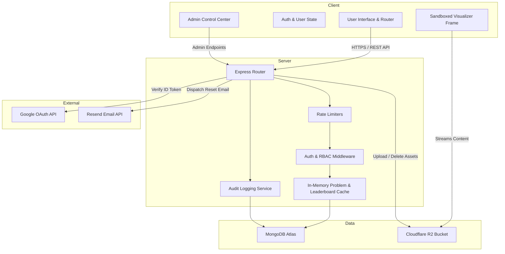

# System Architecture

This document describes the high-level architecture of the DSA Sheet platform, detailing components, data boundaries, and communication flows.

## 1. High-Level Architecture

The DSA Sheet platform follows a decoupled client-server architecture:
- **Frontend**: Single Page Application (SPA) built with React 18, Vite, TypeScript, and Tailwind CSS.
- **Backend**: RESTful API server built on Node.js and Express 5.
- **Database**: MongoDB Atlas managed via Mongoose ODM.
- **Asset Storage**: Cloudflare R2 (S3-compatible) for standalone interactive HTML/JS visualizers.
- **Third-Party Services**: Google Identity Services (OAuth 2.0) and Resend (transactional email).

## 2. Tier Breakdown

### 2.1 Presentation Tier (`client/`)
- **Technology**: React 18, TypeScript, Tailwind CSS, Lucide icons, Vite.
- **State Management**: React Context (`AuthContext.tsx`) for global user state; local component state and `useMemo` for tabular search and filter indexing.
- **Routing & Code Splitting**: `react-router-dom` with route guards (`AdminRoute.tsx`), route-level dynamic code splitting (`React.lazy` and `Suspense`), separating public landing, authenticated user portal, and role-gated admin views (`/admin`).
- **Resilience**: `ErrorBoundary.tsx` wrapping main views to catch unexpected rendering exceptions without crashing the user session.

### 2.2 Application Tier (`server/`)
- **Technology**: Express 5.x on Node.js (CommonJS).
- **Security Middleware**: `helmet`, `cors` (configured with strict whitelist), custom account lockout limiter, and JWT bearer token parser.
- **Route Handlers**:
  - `routes/auth.js`: Authentication, credential hashing, Google OAuth verification, password recovery.
  - `routes/problems.js`: Problem bank indexing, completion tracking, personal notes.
  - `routes/topics.js`: Canonical topic listing and taxonomy.
  - `routes/visualizers.js`: Visualizer metadata streaming and asset retrieval.
  - `routes/daily.js`: Problem of the Day (POTD) scheduling and progression.
  - `routes/admin.js`: Privileged CRUD operations, bulk management, and system auditing.

### 2.3 Data & Storage Tier
- **MongoDB Atlas**: Document store holding users, problems, topics, visualizer metadata, daily challenge records, and audit logs.
- **In-Memory Cache**: Low-latency cache inside `server/routes/problems.js` and `server/routes/leaderboard.js` to serve high-volume reads without querying MongoDB on every request.
- **Cloudflare R2**: Object storage for interactive HTML visualizer bundles (`.html`), accessed via presigned URLs or public asset CDN.

## 3. Core Architectural Patterns

1. **In-Memory Cache with Explicit Invalidation**:
   - High-throughput public endpoints (`/api/problems`, `/api/leaderboard`) utilize in-memory caches.
   - Any write mutation (Admin problem update, topic creation, solution submission) immediately triggers cache clearing functions (`clearProblemsCache()`, `clearLeaderboardCache()`).

2. **Soft Deletion Paradigm**:
   - Critical entities (`Problem`, `Topic`, `Visualizer`) implement `isDeleted: Boolean` and `deletedAt: Date`.
   - Admin UI provides toggles for "Live" vs "Deleted" and allows instant restoration without data loss.

3. **Canonical Taxonomy Normalization**:
   - The helper `getCanonicalTopicSlug` ensures topic identifiers remain uniform between frontend routes, database queries, and URL slugs (e.g., standardizing `basics` and `basic`).

4. **Progressive Level Formula**:
   - User level progression is computed deterministically from total solved count:

$$
\text{Level} = \lfloor\sqrt{\text{totalSolved} \times 0.45}\rfloor + 1
$$

