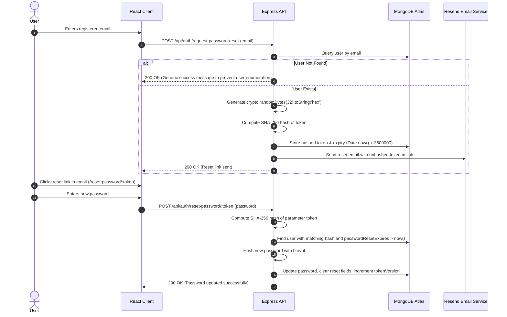

# Authentication & Authorization

This document details the security architecture, authentication lifecycle, Role-Based Access Control (RBAC), and session revocation mechanisms implemented in the platform.

---

## 1. Authentication Mechanisms

### 1.1 Local Email & Password
- **Registration**: Accepts `username`, `email`, and `password`. The password must meet minimum length requirements and is hashed using `bcryptjs` with 10 salt rounds before storage.
- **Login**: Compares incoming plaintext password against the stored bcrypt hash.
- **Brute-Force Protection & Account Lockout**:
  - Failed authentication attempts increment `failedLoginAttempts`.
  - Reaching 5 consecutive failures triggers an account lockout: `lockUntil` is set to 15 minutes into the future.
  - While locked, all login attempts are rejected with `429 Too Many Requests` or `401 Unauthorized` lockout notices.
  - A successful login resets `failedLoginAttempts = 0` and clears `lockUntil`.

### 1.2 Google OAuth 2.0
- **Client Flow**: Uses Google Identity Services (`@react-oauth/google` or Google One-Tap). The browser receives a signed credential (ID Token) from Google.
- **Server Verification**: The backend verifies the cryptographic signature of the ID token using `google-auth-library` and the configured `GOOGLE_CLIENT_ID`.
- **Account Association**:
  - If a user with the Google account's email already exists, their account is linked (`googleId` and `authProvider: 'google'`).
  - If no account exists, a new user is automatically provisioned without requiring a manual password.

---

## 2. Token Lifecycle & Session Management

- **Format**: Standard JSON Web Tokens (JWT) signed with `HS256` using the server environment secret `JWT_SECRET`.
- **Payload**:
  ```json
  {
    "id": "60d0fe4f5311236168a109ca",
    "role": "user",
    "iat": 1714489200,
    "exp": 1715094000
  }
  ```
- **Client Storage**: Stored in `localStorage` as `token` and transmitted on authenticated requests via the HTTP header:
  ```http
  Authorization: Bearer <jwt_token>
  ```
- **Global & Per-User Revocation**:
  - `User.tokenVersion`: When incremented (e.g., on password reset or manual session kill), any token issued under an older version is immediately rejected by `middleware/auth.js`.
  - `User.tokensInvalidBefore`: Rejects any token whose issuance time (`iat`) predates this timestamp.

---

## 3. Role-Based Access Control (RBAC)

The platform defines the following user roles in `models/User.js`:

| Role | Permissions |
| :--- | :--- |
| `user` | Standard student access: browse topics, view visualizers, mark problems solved, add personal notes, view leaderboard, access POTD. |
| `moderator` | Standard user permissions plus community comment and report moderation. |
| `content_manager` | Can draft and update problem descriptions, curate hints, and review visualizers. |
| `admin` | Full administrative control: manage problems, topics, visualizer deployments, view audit logs, adjust leaderboard settings, and manage user roles. |

### Middleware Verification
- **`middleware/auth.js`**: Decodes Bearer JWT, confirms user exists, checks `isActive === true`, verifies account is not locked, and attaches `req.user` to the Express request context.
- **`middleware/admin.js`**: Enforces that `req.user.role === 'admin'`. Rejects unprivileged users with `403 Forbidden`.

---

## 4. Password Recovery Flow



