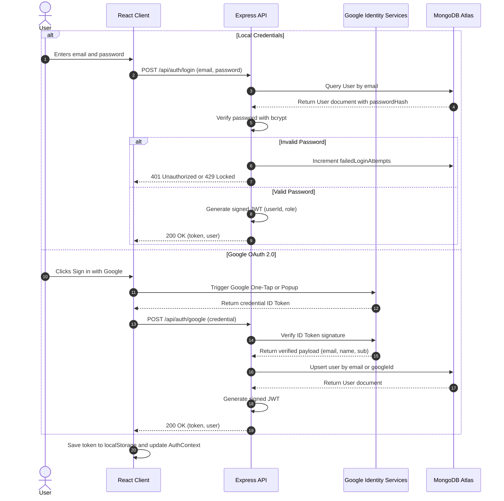
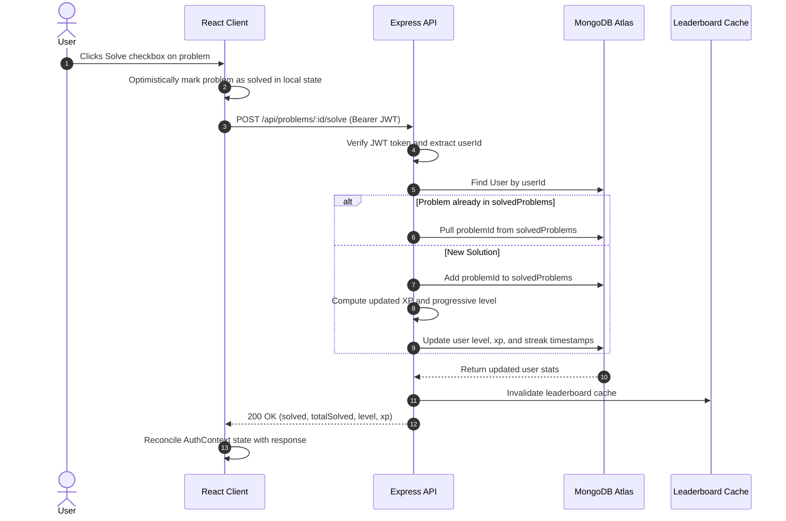
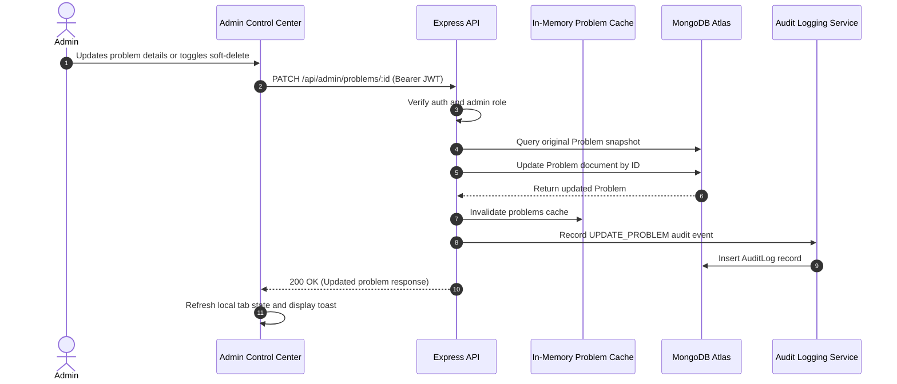
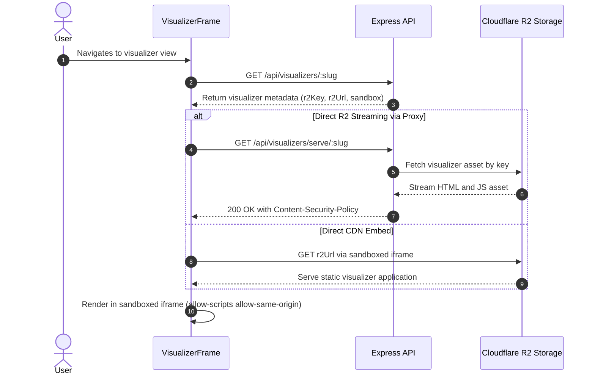

# Data Flow & Sequence Diagrams

This document illustrates the primary operational flows and data lifecycles across the client, server, database, and third-party services.

## 1. User Authentication Flow

## 2. Problem Solving & Progression Flow

## 3. Admin Mutation & Cache Invalidation Flow

## 4. Sandboxed Visualizer Streaming Flow

